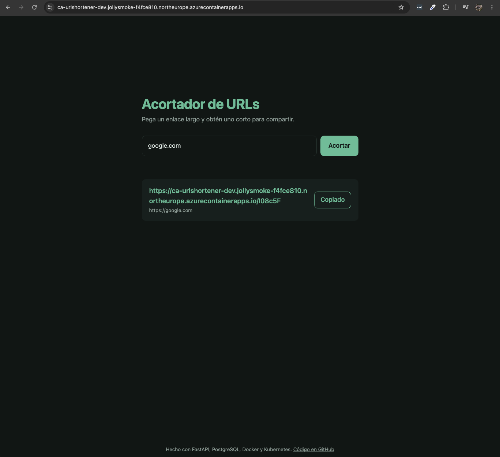
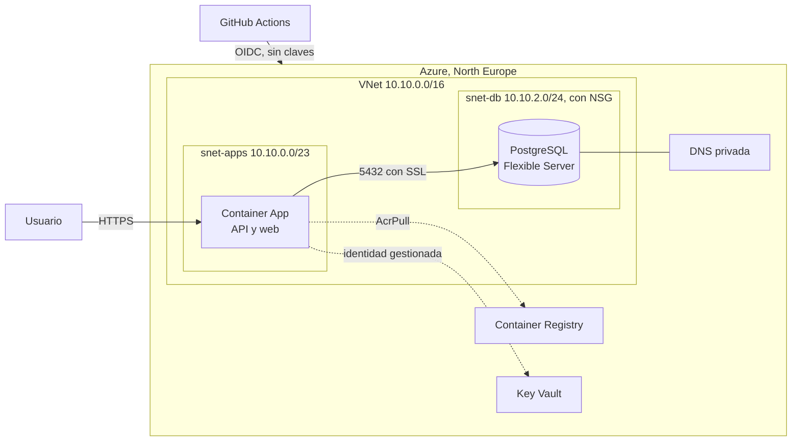

# URL Shortener en Azure

Es el mismo acortador de URLs de [URL-Shortener](https://github.com/Martinlakke/URL-Shortener), que primero monté en AWS con Kubernetes. Aquí lo he llevado a Azure, pero esta vez con servicios gestionados y corrigiendo las cosas que en el primero hice regular: el estado de Terraform en local, la contraseña en un Secret de Kubernetes, las claves de AWS guardadas en GitHub...



## Cómo está montado



La app corre en Container Apps, con HTTPS, y se apaga sola cuando nadie la usa. La base de datos está en una subred privada sin acceso desde internet, y el NSG solo deja pasar el puerto 5432 desde la subred de la app. Para que la app encuentre la base de datos por su nombre hay una zona DNS privada enlazada a la red.

No hay contraseñas en ningún sitio. La de la base de datos la genera Terraform y la guarda directamente en Key Vault, y la app la lee con su identidad gestionada, que es la misma que usa para descargar la imagen del registro.

## Carpetas

```
.
├── app/                      la API (FastAPI), la web y el Dockerfile
├── terraform/
│   ├── providers.tf          provider y backend remoto
│   ├── main.tf               resource group, registro, Key Vault y los módulos
│   ├── app.tf                Container Apps
│   └── modules/
│       ├── network/          VNet, subredes y NSG
│       └── database/         PostgreSQL y DNS privada
├── .github/workflows/
│   ├── infra.yml             plan, apply y destroy
│   └── deploy.yml            construir y desplegar la app
└── docker-compose.yml        para probar en local
```

## Probarlo en local

```bash
docker compose up --build
```

Y la web en http://127.0.0.1:8000.

## Antes de nada: el bootstrap

Hay dos cosas que creé a mano una sola vez, con la CLI, porque Terraform las necesita para funcionar y no se pueden destruir con el resto:

- La cuenta de almacenamiento donde se guarda el estado de Terraform.
- La identidad que usan los pipelines para entrar en Azure, con su credencial federada para este repo.

Si la identidad estuviera dentro de lo que gestiona Terraform, al hacer un `destroy` se borraría y el pipeline ya no podría volver a entrar para recrearlo.

## Desplegar

Desde la pestaña Actions hay dos workflows:

- **Infraestructura (Terraform):** eliges `plan`, `apply` o `destroy`. Siempre lanzo primero un `plan` para ver qué va a hacer.
- **Desplegar en Azure:** construye la imagen, la etiqueta con el commit y actualiza la app.

Los dos entran en Azure con OIDC. GitHub les da un token firmado que dura unos minutos y Azure solo lo acepta si viene de este repo y de la rama `main`, así que en GitHub no hay ninguna clave guardada.

Terraform se encarga de la infraestructura y el pipeline de desplegar versiones. Para que no se pisen, Terraform ignora los cambios en la imagen de la app.

Lo he probado destruyendo todo desde GitHub y volviéndolo a crear desde cero.

## Problemas que me encontré

- West Europe no aceptaba clientes nuevos con mi cuenta de prueba, así que me fui a North Europe.
- Al crear la cuenta de almacenamiento me salía que no encontraba la suscripción. El problema de verdad era que no tenía registrado el proveedor `Microsoft.Storage`, cosa que pasa en suscripciones nuevas.
- En las cuentas de prueba no se pueden usar las ACR Tasks para construir imágenes en Azure. Además mi Mac es ARM y Azure x86, así que al principio las construía con `docker buildx --platform linux/amd64`. Ahora lo hace el pipeline.
- Al crear PostgreSQL, Azure añadió un service endpoint a la subred y Terraform quería quitarlo. Antes de aplicar miré por qué estaba ahí y lo pasé al código.
- El login con OIDC fallaba porque GitHub ahora mete los identificadores del usuario y del repo en el subject (`usuario@id/repo@id`). Tuve que poner exactamente ese texto en la credencial federada.
- Si la base de datos está parada, Terraform no puede hacer ni un `plan`. El pipeline la enciende antes por si acaso.
- Al recrear todo, la app necesita una imagen que todavía no existe porque el registro es nuevo. El `apply` del pipeline crea primero el registro, sube la imagen y luego crea lo demás.
- El permiso de Key Vault se lo daba a "quien lanzara Terraform", así que cambiaba según lo lanzara yo o el pipeline. Lo cambié por un mapa con `for_each` y usé un `moved` para no recrear el que ya existía.

## Diferencias con la versión de AWS

| AWS | Azure |
|---|---|
| Estado de Terraform en mi PC | Estado remoto, con bloqueo y versiones |
| Módulos oficiales | Módulos propios |
| Postgres dentro del clúster, sin persistencia | PostgreSQL gestionado y privado |
| Contraseña en un Secret de Kubernetes | Contraseña en Key Vault, generada por Terraform |
| Claves de AWS en GitHub | OIDC, sin claves |
| Imágenes con `latest` | Imágenes con el commit |
| HTTP en el 8000 | HTTPS |

## Lo siguiente

Me gustaría separar la identidad de los pipelines en dos (una para la infraestructura y otra solo para desplegar, con menos permisos), lanzar el `plan` en cada pull request y que la app entre en PostgreSQL con su identidad de Entra ID, sin contraseña.
